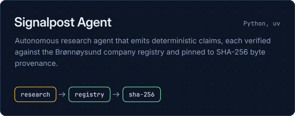
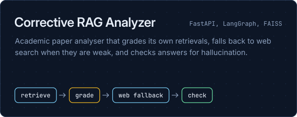
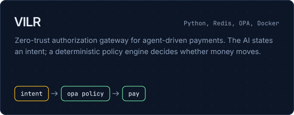
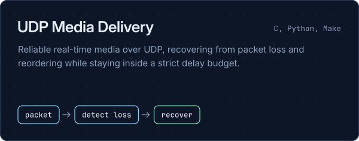
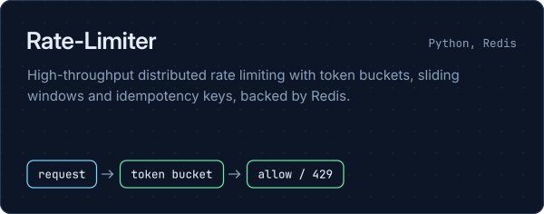

### What I work on

<table>
  <tr>
    <td width="50%" valign="top">
      <strong>Agent workflows and RAG</strong> 
      Deterministic claim derivation, registry ground truth, corrective RAG and LangGraph pipelines.
    </td>
    <td width="50%" valign="top">
      <strong>Backend architecture</strong> 
      Low-latency APIs in Python (FastAPI) and Node.js, with reverse-proxy auth patterns.
    </td>
  </tr>
  <tr>
    <td width="50%" valign="top">
      <strong>Systems and security</strong> 
      Zero-trust payment gateways, cryptographic audit trails, rate limiting and UDP networking.
    </td>
    <td width="50%" valign="top">
      <strong>Open source</strong> 
      Upstream work on Kotlin agent harnesses, GraphRAG engines and auth proxies.
    </td>
  </tr>
</table>

### Things I've built

Each card shows how the project works. Amber is model output, blue is data, green is a deterministic check.

  
  
  
  
  

### Open source contributions

| Project | Upstream | What I worked on |
| :--- | :--- | :--- |
| **BossConsole** | [`risa-labs-inc/BossConsole`](https://github.com/risa-labs-inc/BossConsole) | Plugin lifecycle and coroutine teardown, MCP observation contracts, crash containment and UI thread safety. |
| **Post-Graph RAG** | [`crajah/post-graph-rag`](https://github.com/crajah/post-graph-rag) | Temporal interval queries for months, half-years and fiscal periods in PostgreSQL-native GraphRAG. |
| **RAG-framework** | [`adaumsilva/RAG-framework`](https://github.com/adaumsilva/RAG-framework) | Recursive character text chunking and OpenAI embedder integration. |
| **OAuth2 Proxy** | [`oauth2-proxy/oauth2-proxy`](https://github.com/oauth2-proxy/oauth2-proxy) | Identity header propagation for NGINX Ingress forward authentication. |

### Stack

### Activity

  
  

  
Languages

   
  
  

**Latest pull requests and issues**

<!--START_SECTION:activity-->
<!--END_SECTION:activity-->

<picture>
  <source media="(prefers-color-scheme: dark)" srcset="https://raw.githubusercontent.com/Sahvendra7/Sahvendra7/output/snake-dark.svg" />
  <source media="(prefers-color-scheme: light)" srcset="https://raw.githubusercontent.com/Sahvendra7/Sahvendra7/output/snake-light.svg" />
  
</picture>
